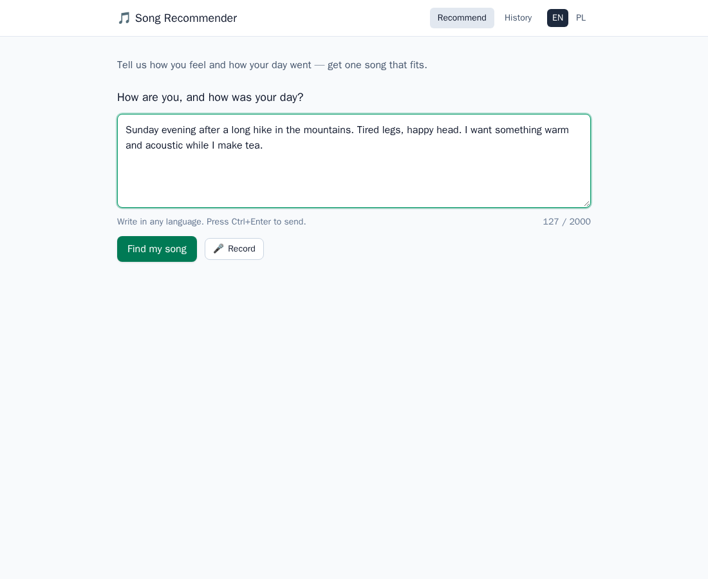
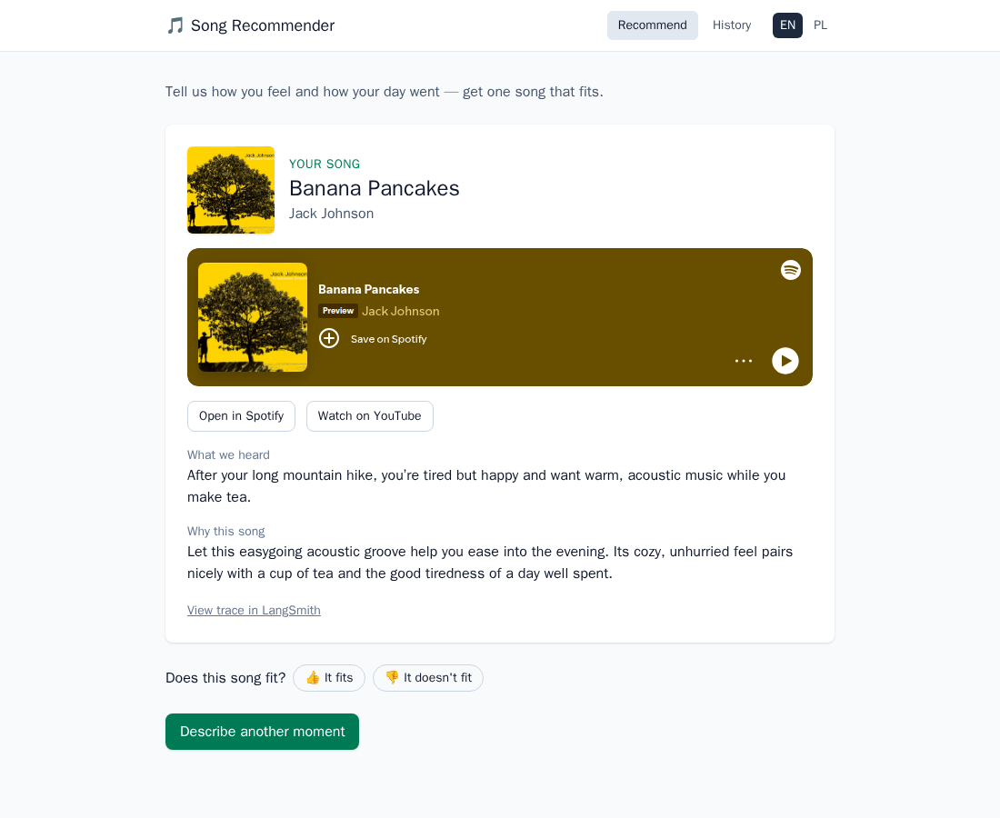
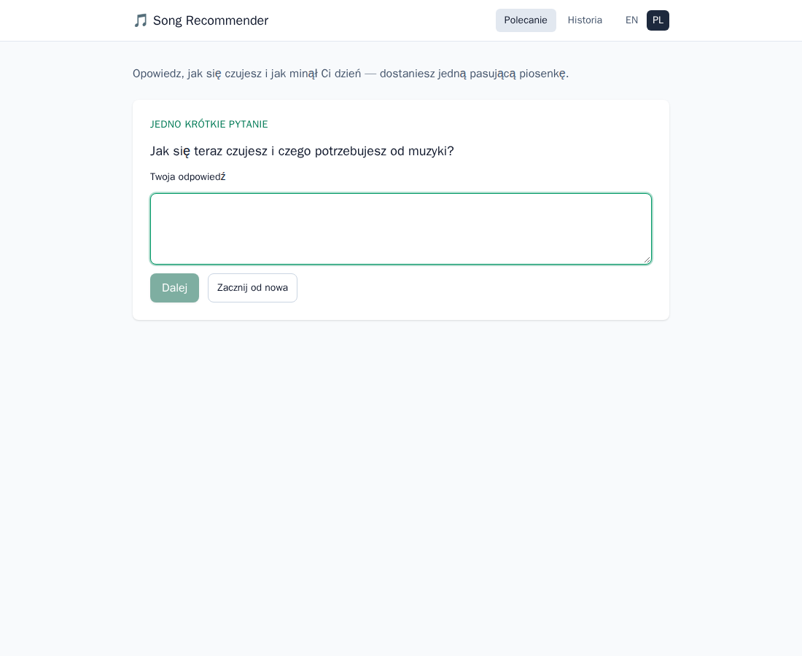
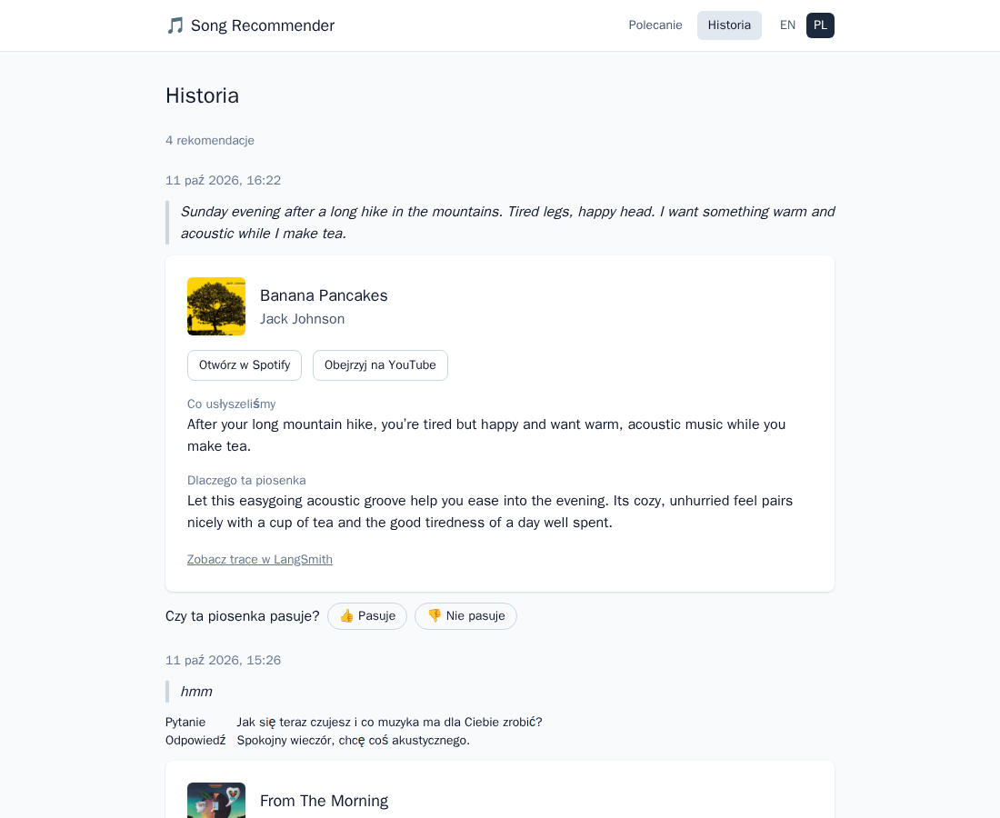

# Song Recommender

Describe how you feel and how your day went, by text or by voice, in Polish, English or any
other language. Two LLM agents turn the description into a song that fits, check that it
exists on Spotify, and explain the choice. You get **one song**, with a Spotify player in the
page, a YouTube link and a short "why this song". The interface is in English and Polish, and
every decision is traced in LangSmith, so the selection logic can be inspected and tuned.

| Describe your day | Get one song, with the reasons |
|---|---|
|  |  |
| **One clarifying question, if needed (Polish UI)** | **History with your ratings** |
|  |  |

## How it works

1. **Need Analyst** (agent 1) reads the description and builds a *Need Profile*: emotions,
   energy, mood, the situation, and what the music should do (calm, uplift, energize, focus,
   comfort, match, release). If the description is too vague, it asks one short question.
2. **Music Curator** (agent 2) proposes three ranked songs for that profile, with an
   explanation for each, written in the interface language.
3. The candidates are **verified on Spotify**. If none exists, the curator tries again on the
   stronger model with feedback (at most three attempts). A YouTube video is looked up for the
   winner.
4. A router sends simple requests to a fast *light* model and complex ones (long, mixed
   feelings) to a stronger *heavy* model.

More in [docs/architecture.md](docs/architecture.md).

## Quick start (Docker)

### Prerequisites

- **Docker** with Compose v2. On Windows: Docker Desktop with *WSL integration* enabled for
  your distribution.
- **API keys:**

  | Service | Needed for | Where to get it |
  |---------|------------|-----------------|
  | OpenAI | both agents (by default) and voice transcription | [platform.openai.com/api-keys](https://platform.openai.com/api-keys) |
  | Spotify | verifying songs, the player, album art | create an app at [developer.spotify.com/dashboard](https://developer.spotify.com/dashboard): any redirect URI (e.g. `http://127.0.0.1:8080/callback`, unused); the owner needs Spotify Premium. Copy the Client ID and secret |
  | YouTube Data API v3 | video links (optional) | [Google Cloud console](https://console.cloud.google.com/): enable "YouTube Data API v3", then Credentials → Create API key |
  | LangSmith | traces, feedback, evaluations (optional) | [smith.langchain.com](https://smith.langchain.com) → Settings → API Keys (a personal access token) |

  Without Spotify the app still works, but songs are unverified. Without YouTube you get
  YouTube search links. Without LangSmith there are no traces.

### Run

```bash
git clone https://github.com/Zorgof/song-recommender.git
cd song-recommender
cp .env.example .env
```

Edit `.env` and fill in at least:

```bash
OPENAI_API_KEY=...
SPOTIFY_CLIENT_ID=...
SPOTIFY_CLIENT_SECRET=...
YOUTUBE_API_KEY=...          # optional
LANGSMITH_API_KEY=...        # optional; without it, tracing is off
# LANGSMITH_WORKSPACE_ID=... # only for organization service keys (lsv2_sk_…)
```

`LLM_LIGHT` and `LLM_HEAVY` are already set to OpenAI models. Then:

```bash
docker compose up --build -d
```

The first build takes a few minutes. Open **http://localhost:8080**.

- The microphone works at `http://localhost:8080`. From another device it needs HTTPS; see
  [Troubleshooting](docs/troubleshooting.md#using-the-microphone-from-another-device-phone-laptop-on-the-lan).
- History is stored in `./data` and survives restarts and rebuilds.
- `docker compose logs -f backend` shows the logs, and `docker compose down` stops the app.
  After pulling new code, run `docker compose up --build -d` again.
- Port 8080 taken? Set `APP_PORT=8081` in `.env`.

If something does not work, see [docs/troubleshooting.md](docs/troubleshooting.md).

## Switching to Anthropic or Gemini

Each model tier is a `provider:model` string in `.env`. Change it, add the provider's key, and
restart with `docker compose up -d`. No code changes are needed.

```bash
# Anthropic (Claude)
LLM_LIGHT=anthropic:claude-haiku-5-5
LLM_HEAVY=anthropic:claude-sonnet-5-5
ANTHROPIC_API_KEY=...          # platform.claude.com → API keys

# Google Gemini
LLM_LIGHT=google_genai:gemini-3.5-flash-lite
LLM_HEAVY=google_genai:gemini-3.8-flash
GOOGLE_API_KEY=...             # aistudio.google.com → API keys

# Mixed, with a fallback when the heavy tier's provider fails
LLM_LIGHT=openai:gpt-6-luna
LLM_HEAVY=anthropic:claude-sonnet-5-5
LLM_HEAVY_FALLBACK=openai:gpt-6.1-sol
```

Voice transcription always uses OpenAI (`OPENAI_API_KEY`); without that key, or with
`STT_PROVIDER=none`, the microphone is hidden and typing still works. The OpenAI setup is tested
end to end; the Anthropic and Gemini setups are tested offline. Every variable is described in
[docs/configuration.md](docs/configuration.md).

## Documentation

| Document | Contents |
|----------|----------|
| [Architecture](docs/architecture.md) | services, agent graph, routing, escalation, language handling, data, API |
| [Configuration](docs/configuration.md) | every environment variable, provider examples, getting the credentials |
| [Observability and tuning](docs/observability-and-tuning.md) | reading a trace, feedback, running evaluations, changing prompts |
| [Troubleshooting](docs/troubleshooting.md) | microphone, YouTube quota, missing keys, Docker, slow requests |
| [Development](docs/development.md) | toolchain, running without Docker, hot reload in Docker, code quality |
| [Requirements](docs/requirements.md), [Implementation plan](docs/implementation-plan.md) | what the app must do, and the original design |
| [Architecture Decision Records](docs/adr/README.md) | what was built in each step, and why |

Component READMEs: [backend](backend/README.md) (API, modules, evaluations) and
[frontend](frontend/README.md).

## Development

Prerequisites: [uv](https://docs.astral.sh/uv/) (installs Python 3.14.8 by itself) and
Node.js 24 LTS (`frontend/.nvmrc`).

```bash
# backend: http://localhost:8000/api/docs
cd backend
uv sync
uv run pytest
uv run uvicorn app.main:create_app --factory --reload

# frontend: http://localhost:5173 (proxies /api to the backend)
cd frontend
npm install
npm test
npm run dev
```

Or run both with hot reload in Docker:
`docker compose -f docker-compose.yml -f docker-compose.dev.yml up --build`. See
[docs/development.md](docs/development.md).

## Tech stack

| Area | Technology |
|------|------------|
| Backend | Python 3.14, FastAPI, LangGraph, LangChain (OpenAI, Anthropic, Gemini), SQLite (SQLAlchemy, Alembic) |
| Speech-to-text | OpenAI `gpt-transcribe` |
| Music catalogs | Spotify Web API, YouTube Data API v3 |
| Observability | LangSmith: traces, feedback, datasets and evaluations |
| Frontend | React 19, TypeScript, Vite, TanStack Query, React Router, Tailwind CSS, react-i18next (EN/PL) |
| Runtime | Docker Compose: backend (uvicorn) and frontend (nginx) |
| Quality | pytest, ruff, mypy (strict); Vitest, Testing Library, oxlint, Prettier |

## Repository layout

```
backend/                FastAPI app, agents, evaluations (Python, uv)
frontend/               React SPA (TypeScript, Vite), nginx config
docs/                   documentation, requirements, implementation plan, ADRs
data/                   SQLite files when running in Docker (git-ignored, except .gitkeep)
docker-compose.yml      the app: http://localhost:8080
docker-compose.dev.yml  development override with hot reload
.env.example            every configuration variable, documented
```

## Privacy

Your descriptions and transcripts are sent to the configured LLM provider and, if tracing is
on, to LangSmith (US region). Voice recordings go to OpenAI for transcription only; they are
not stored and not sent to LangSmith. History stays in `./data` on your machine.
