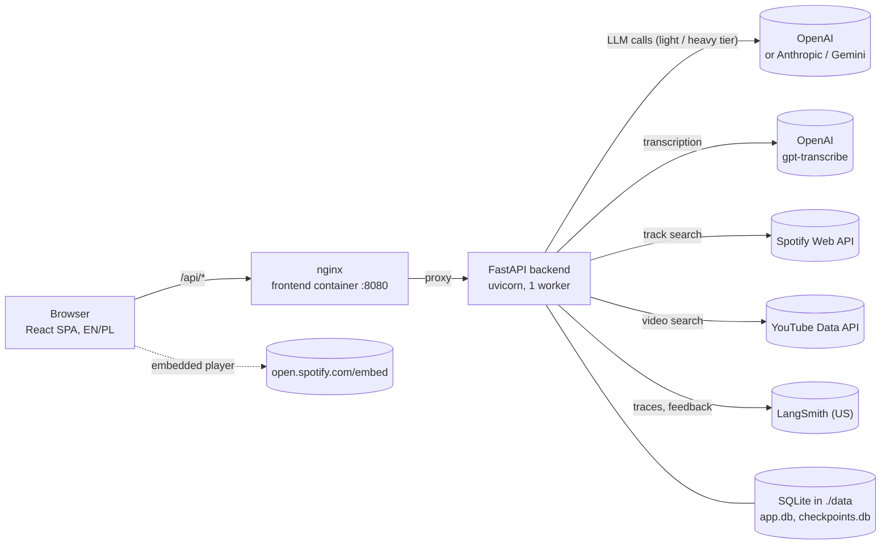
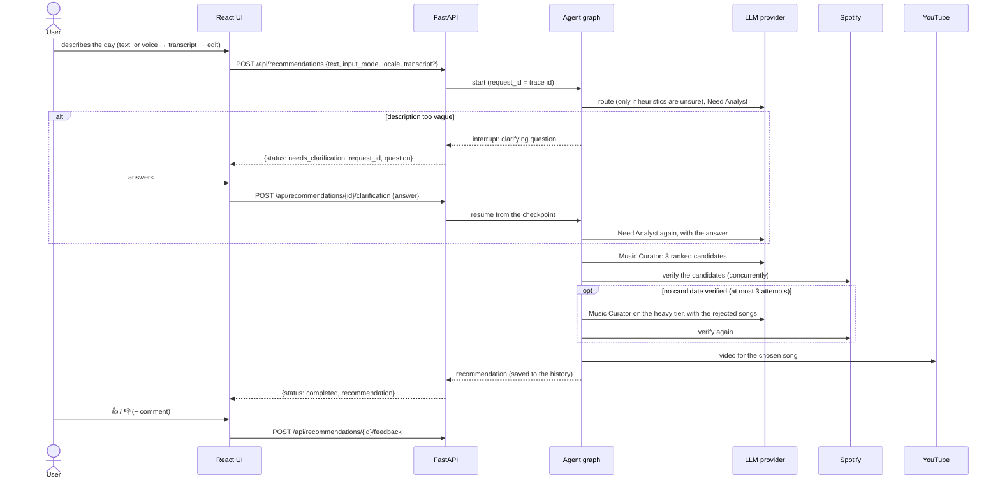
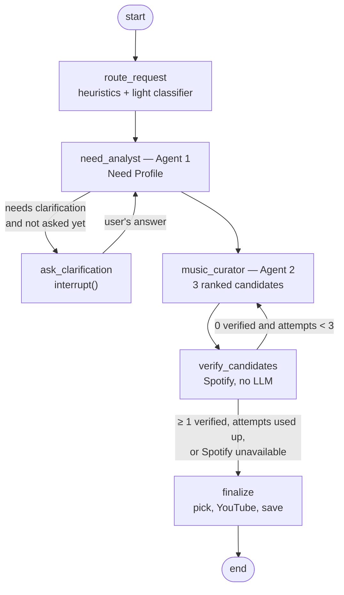

# Architecture

How the Song Recommender works: the services, the agent graph, routing and escalation,
language handling, persistence and the API. Decisions behind each part are recorded in the
[ADRs](adr/README.md); the [implementation plan](implementation-plan.md) is the original design.

## System overview



| Part | Technology | Notes |
|------|------------|-------|
| Frontend | React 19, TypeScript, Vite, TanStack Query, React Router, Tailwind CSS, react-i18next | Served by nginx in Docker; nginx also proxies `/api` (see [frontend/nginx.conf](../frontend/nginx.conf)) |
| Backend | Python 3.14, FastAPI, LangGraph, LangChain | One process: the app keeps the Spotify token and the YouTube quota pause in memory |
| Storage | SQLite + SQLAlchemy (async) + Alembic | Migrations run at startup |
| Observability | LangSmith | One trace per recommendation; user ratings become LangSmith feedback |

API keys stay in the backend. The browser only sees `/api/meta`, which reports what is
configured (models, STT, LangSmith) without secrets.

## A recommendation, end to end



Voice input adds one step in front: the browser records with `MediaRecorder` (at most 90 s),
`POST /api/transcriptions` returns the text and the detected language, and the user edits the
transcript before sending it. The audio goes to the transcription provider only; it is neither
stored nor traced.

## Agent graph

The graph is built with LangGraph ([backend/app/agents/graph.py](../backend/app/agents/graph.py)).



| Node | Kind | What it does |
|------|------|--------------|
| `route_request` | heuristics, sometimes a light LLM call | Decides the request's complexity, which selects the tier of both agents (see Routing) |
| `need_analyst` | LLM, structured output | Turns the description into a **Need Profile**: summary, emotions, energy and valence (0–1), day context, the goal of the music (`match`, `uplift`, `calm`, `energize`, `focus`, `comfort`, `release`), target energy, musical hints, things to avoid, confidence, and a rationale. May ask one clarifying question |
| `ask_clarification` | `interrupt()` | Pauses the run; the API returns the question. The paused state is stored in `checkpoints.db`, so an answer works even after a restart. Asked at most once |
| `music_curator` | LLM, structured output | Proposes 3 ranked songs for the profile, each with a rationale, fit notes and a 2–3 sentence explanation for the user. Its prompt lists the recently recommended songs (excluded) and the songs rejected in earlier attempts |
| `verify_candidates` | Spotify lookups | Searches each candidate (title and artist must both score ≥ 85 in fuzzy matching). Drops duplicates and songs recommended recently |
| `finalize` | YouTube lookup, database | Takes the best-ranked verified song, looks up a video, saves the result. Without a verified song it returns the curator's best candidate with Spotify and YouTube **search** links marked unverified |

Prompts are versioned files in [backend/app/agents/prompts/](../backend/app/agents/prompts/):
`router.v1.md`, `need_analyst.v1.md`, `curator.v1.md`. The highest version of each is loaded and
recorded on every trace. See [Observability and tuning](observability-and-tuning.md#changing-a-prompt).

## Routing

Two tiers of models are configured: **light** (fast, cheap) and **heavy** (better reasoning).
Routing picks the tier for both agents from the complexity of the request
([backend/app/llm/routing.py](../backend/app/llm/routing.py)):

| Heuristic verdict | Rule |
|-------------------|------|
| `uncertain` | fewer than 5 words |
| `complex` | 150 words or more |
| `complex` | 2 or more contrast markers ("but", "however", "at the same time", "ale", "jednak", "z drugiej strony", …, in English and Polish) |
| `simple` | up to 60 words (90 for voice input, which is wordier) and no contrast marker |
| `uncertain` | everything else (one contrast marker, or a medium length) |

An `uncertain` verdict goes to a light-model **classifier** (`router.v1.md`), which answers
`simple` or `complex`. If the classifier fails, the request is routed as complex (the safe
choice).

| Complexity | Need Analyst | Music Curator |
|------------|--------------|---------------|
| simple | light | light |
| complex | heavy | heavy |

The routing decision (complexity, source, reasons) is stored in the trace metadata.

## Escalation and fallbacks

| Situation | What happens | Recorded as |
|-----------|--------------|-------------|
| The model's output does not match the schema, on light | The same call is repeated once on heavy | escalation `invalid_structured_output`, tag `escalated` |
| The output is invalid on heavy | The request fails: `502 llm_invalid_output` | error code on the request |
| No candidate of an attempt is verified on Spotify | The next curator attempt runs on heavy, with the rejected songs and their reasons as feedback; at most 3 attempts | escalation `no_verified_candidates` |
| All 3 attempts fail verification | The best candidate is returned with unverified search links | `spotify_verified: false` |
| The provider of a tier fails (network, 5xx, rate limit after the SDK's retries) | The tier's fallback model (`LLM_<TIER>_FALLBACK`) is tried; without one: `503 llm_unavailable` | — |
| Spotify is not configured or unreachable | Verification stops (retrying would not help); the result has unverified links and no player | log warning |
| YouTube quota used up or YouTube unreachable | A YouTube search link, marked unverified; after a quota error no call is made until midnight Pacific time | log warning |

Structured output uses each provider's native mechanism: JSON schema for OpenAI and Anthropic
([ADR-02.1](adr/step-02.1-anthropic-structured-output.md)), LangChain's default for Gemini. The
parsed result is always validated with Pydantic.

## Language handling

- The interface is in **English or Polish**. The switcher stores the choice in the browser; the
  first visit follows the browser language, with English as the fallback.
- The **description may be in any language**. Voice input is transcribed with automatic
  language detection: no hint is sent, because a user may speak Polish with the UI in English.
- Every request carries the UI `locale`. The agents **reason in English**: the Need Profile,
  rationales and fit notes are in English, so traces are comparable across languages.
- Only the texts shown to the user are written in the UI language: `summary_localized` (shown
  as "What we heard"), the clarifying question and the explanation.
- Error messages are translated in the frontend: the backend returns a stable `error.code`, and
  the UI maps it to a message in `locales/en.json` / `locales/pl.json`.

## Persistence

| Store | Contents |
|-------|----------|
| `app.db` — `recommendations` | id (= request id = trace id), time, locale, input text and mode, clarification question and answer, Need Profile, chosen song, links and their verification flags, explanation, models used, escalated flag, status (`pending`, `needs_clarification`, `completed`, `failed` with the error code) |
| `app.db` — `feedback` | one rating per recommendation (rating again replaces it), comment, `synced_to_langsmith` |
| `app.db` — `track_link_cache` | Spotify and YouTube lookups by normalized "artist\|title"; found results are kept 30 days, "not found" 1 day; saves YouTube quota |
| `checkpoints.db` | LangGraph checkpoints: the state of runs paused at the clarifying question |

Both files live in `DATA_DIR` (`./data` on the host when running in Docker). The history
excludes songs from the last `HISTORY_EXCLUDE_LAST_N` recommendations.

## REST API

| Method and path | Body / params | Response |
|-----------------|---------------|----------|
| `GET /api/health` | — | `{status, database}`; 503 when the database is unreachable |
| `GET /api/meta` | — | configured models per tier, STT, catalogs, LangSmith, locales (no secrets) |
| `POST /api/transcriptions` | multipart `audio` (webm/ogg/mp4/wav, ≤ 10 MB) | `{text, language, duration_s}` |
| `POST /api/recommendations` | `{text, input_mode, locale, transcript?}` | `{status: "completed", recommendation}` or `{status: "needs_clarification", request_id, question}` |
| `POST /api/recommendations/{id}/clarification` | `{answer}` | the same union |
| `POST /api/recommendations/{id}/feedback` | `{score: "up" \| "down", comment?}` | `204` |
| `GET /api/recommendations` | `?limit=20&offset=0` | completed recommendations, newest first, with feedback and trace link |

The OpenAPI schema and Swagger UI are at `/api/docs`. Errors have one shape,
`{"error": {"code", "message"}}`:

| Code | HTTP | Meaning |
|------|------|---------|
| `validation_error` | 422 | invalid request (e.g. text under 3 or over 2000 characters) |
| `not_found` | 404 | unknown recommendation id |
| `conflict` | 409 | e.g. answering a question that is not waiting for an answer |
| `llm_unavailable` | 503 | the model provider failed (and the fallback, if any) |
| `llm_invalid_output` | 502 | the heavy model returned output that does not match the schema |
| `catalog_unavailable` | 503 | a catalog failure that cannot be degraded; not returned today, because an unavailable Spotify gives unverified links instead |
| `stt_unavailable` | 503 | speech-to-text disabled or failing |
| `audio_too_large` | 413 | recording over 10 MB (also returned by nginx over 11 MB) |
| `unsupported_audio_format` | 415 | not webm/ogg/mp4/wav |
| `invalid_audio` | 422 | empty, corrupted or too short recording |
| `internal_error` | 500 | unexpected error |
| `network_error` | — | produced by the frontend (and by nginx as 502) when the backend cannot be reached |

## Frontend

- Pages: **Home** (the recommendation flow) and **History** (20 per page, `?page=N`).
- Home states: input → (recording → transcribing → reviewing) → thinking → (clarifying →
  thinking) → result, or an error that keeps the text and offers a retry.
- The result card shows album art, title and artist, the Spotify embed (verified tracks only),
  Spotify and YouTube links with "unverified" badges on search links, "What we heard", "Why
  this song", and a link to the LangSmith trace when tracing is on.
- The microphone button appears only when `/api/meta` reports STT enabled and the browser
  allows recording (a secure context: `localhost` or HTTPS).

## Repository layout

```
backend/
  app/            FastAPI app: api/, agents/ (graph, nodes, prompts), llm/, music/, stt/,
                  db/ (models, migrations), observability/
  evals/          LangSmith evaluation: dataset, target, evaluators, judge prompt, CLI
  tests/          pytest, offline (fake LLMs, mocked HTTP)
  Dockerfile
frontend/
  src/            api/, components/, pages/, i18n/, locales/, lib/, test/
  Dockerfile, nginx.conf
docs/             this documentation, requirements, implementation plan, ADRs
data/             SQLite files when running in Docker
docker-compose.yml, docker-compose.dev.yml, .env.example
```
